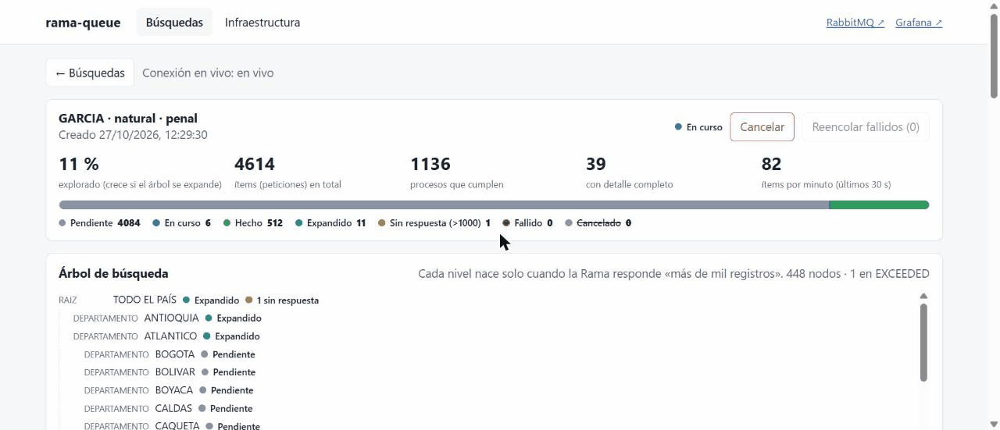
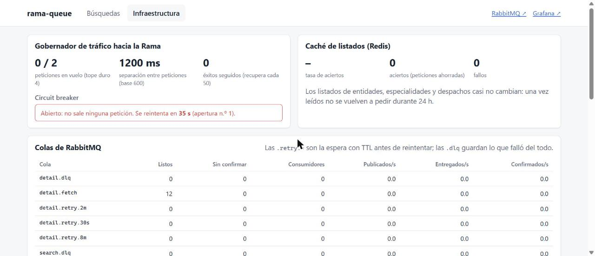
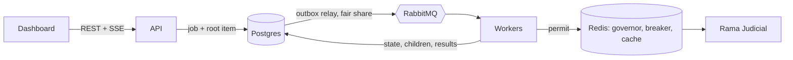

# rama-queue

Large-scale search over the public court-case API of Colombia's Judicial Branch (*Rama Judicial*), built as an infrastructure exercise: **RabbitMQ** distributes the work, **Postgres** is the source of truth, **Redis** governs the traffic to the remote server, and everything runs with **Docker Compose**.

The API answers `400` when a search matches more than 1,000 cases and blocks (`403`) clients that push too hard. To find *all* the cases of a name, the system walks down a territorial tree (department → municipality → entity → specialty → court), making thousands of requests while **staying friendly to the server** and **never letting the queue hang**.

A search is: **name** + **person type** (natural / legal) + **one category** (criminal, civil, labor, family, asset forfeiture). The system decides the rest.



## Features
- One message = one HTTP request. A message is only a pointer `{jobId, itemId, type}`; the state lives in Postgres
- Transactional outbox: items are born in Postgres and a relay publishes them to RabbitMQ, so nothing is lost if the broker or a worker dies
- Automatic drill-down only when the server says "more than 1,000"; a court that still exceeds the limit is reported as *no answer* instead of failing the job
- Traffic governor in Redis shared by all workers: in-flight limit, spacing between requests, and an adaptive (AIMD) limit that halves concurrency on a block and recovers slowly
- Circuit breaker that *stops the consumers* when the server blocks (no requests, no retries burned) and resumes after a growing cool-down
- Retries through TTL wait queues (30 s / 2 min / 8 min), a dead-letter queue, and requeue from the dashboard
- Fair sharing between jobs: a small search is not stuck behind a huge one
- Live dashboard (React + TypeScript): progress over SSE, search tree, results, queues, governor, breaker, DLQ and a chaos panel
- Prometheus + Grafana, and a simulated Rama server with synthetic data and chaos controls
- Hexagonal architecture with a pure domain, enforced by ArchUnit, and tests against real Postgres, Redis and RabbitMQ



## How it works


1. `POST /api/jobs` stores the job and its root item in one transaction. The outbox relay publishes pending items to RabbitMQ, choosing them with the fair-share rule.
2. A worker claims one item, asks the governor for a permit, makes the single HTTP request and, in one transaction, stores the final state, the child items and any matching cases.
3. If the server answers "more than 1,000", the item expands into the next territorial level. On a block, the breaker opens and the consumers stop; transient errors go to a wait queue and come back by themselves.
4. When no active items remain, the job ends as `COMPLETED`, or `PARTIAL` if some branch still exceeded the limit at the lowest level.

Item ids are deterministic (a hash of job, type, code, page and case), so a redelivered message is harmless.

## Quick start
Requirements: Docker. By default the system queries a **simulated** Rama server with synthetic data, so no real person appears anywhere.

```
docker compose up -d --build
```

| What | Where |
|---|---|
| Dashboard | http://localhost:8088 |
| RabbitMQ management | http://localhost:15672 (`ramaqueue` / `ramaqueue`) |
| Grafana | http://localhost:3000 |
| Prometheus | http://localhost:9090 |
| REST API | http://localhost:8087/api/jobs |
| Simulated Rama | http://localhost:8089 |

Demo names (natural persons): `ORTIZ` (one level down), `GONZALEZ`, `LOPEZ`, `MARTINEZ`, `GARCIA` (down to the court level, with branches that get no answer). Legal person: `ANDINA`. Two-word names such as `SERGIO GUTIERREZ` give small searches.

To query the **real** service, copy `.env.example` to `.env`, set `RAMA_BASE_URL` and run `docker compose up -d`. It is an external server: the default pace is deliberately slow (one request in flight, 2 s apart) and adapts by itself.

For development, run only the infrastructure with `docker compose up -d postgres rabbitmq redis`.

## API
| Method | Path | Description |
|---|---|---|
| POST | `/api/jobs` | Create a search `{nombre, tipoPersona: nat\|jur, categoria}` |
| GET | `/api/jobs`, `/api/jobs/{id}` | Recent jobs; progress (counts by state, progress, cases found) |
| GET | `/api/jobs/{id}/results` | Cases found, with filters (`ciudad`, `departamento`, `texto`, `soloCompletos`) and pagination |
| GET | `/api/jobs/{id}/tree` | Search tree, including branches with no answer |
| POST | `/api/jobs/{id}/cancel` | Cancel a job |
| POST | `/api/jobs/{id}/requeue` | Retry the failed items of a job |
| GET | `/api/jobs/{id}/events` | Live progress (SSE) |
| GET | `/api/infra/colas`, `/governor`, `/dlq`, `/peticiones` | Queues, governor and breaker, dead letters, outgoing requests per 10 s |
| POST | `/api/infra/dlq/requeue` | Requeue everything in the DLQs |
| POST | `/api/admin/consumidores/pausar`, `/reanudar`, `/concurrencia` | Pause, resume and resize the consumers (reaches the workers through Redis) |
| POST | `/api/admin/workers/caida` | Demo only: one worker dies without acknowledging |

## Data model
- `search_job`: one search, with its state
- `work_item`: one item = one HTTP request, and also the outbox (`published_at IS NULL` means unpublished)
- `proceso_hit`: cases that match, with detail, last action and parties
- `request_log`: every outgoing request, used for the dashboard histogram

## Results
Measured, not simulated:
- **Against the real service**, a legal-person search for a large company ran for about 2 h 08 min: 1,039 items, 195 cases found, all with full detail, **0 failed items**. About 16 % of the roughly 1,230 requests hit server errors (148 `502`, 34 timeouts, 9 blocks, 4 `503`) and were all absorbed by retries and the breaker.
- **Fair sharing** (simulated server, same pace): a small search launched while a huge one was running finished in **335 s** instead of about 650 s; the huge one took about 10 % longer (756 s instead of about 700 s) and was never starved.

## Chaos testing
From the *Infraestructura* tab of the dashboard:
1. Start a `GARCIA` search and watch the tree grow and the queues move.
2. **Block** the simulated server for 30 s: the breaker opens, the consumers stop, the server sees a handful of `403`s, and the job continues afterwards.
3. **Kill a worker**: the container dies without acknowledging, Docker restarts it and RabbitMQ redelivers.
4. **Pause / resume** and change the **concurrency** live.
5. Break some items on purpose, then requeue the DLQ.

`docker compose up -d --scale worker-detail=3` adds workers; the Redis governor keeps the global limit.

## Tests
```
./mvnw verify              # ~170 tests: domain, architecture, real Postgres/Redis/RabbitMQ (Testcontainers), end to end
cd dashboard && npm test   # UI logic
```
The end-to-end tests start real containers plus a fake Rama over HTTP and compare each job's result with an independently computed reference. They take several minutes on a loaded machine.

## Project layout
```
app/        Spring Boot 3.5 / Java 21 application (domain · application · infrastructure)
mock/       the simulated Rama server, with chaos controls under /__admin
dashboard/  React + TypeScript + Vite
infra/      Prometheus, Grafana and RabbitMQ configuration
docs/       images for this README
```
Domain names in the code are in Spanish (the domain is Colombian); technical terms are in English.

## Design notes
- **Outbox instead of publishing from the handler.** Postgres stays the truth and the broker is just a transport, at the cost of one extra hop (the relay).
- **The governor lives in Redis, not in each worker.** The limit holds with any number of workers, at the cost of a Redis round trip per request.
- **Slow on purpose.** Time was traded for being friendly to the server: the pace starts low and the breaker prefers waiting to insisting.
- **No dead-letter on the work queues.** An unexpected failure drops the message and a watchdog recovers the item from Postgres, so a poison message can never loop.

## Limitations and ideas
- Fair sharing is between *jobs*; there are no users, authentication, ownership or quotas.
- Repeated searches are not reused. Next: reuse a recent identical job (normalized name, person type, category) within a configurable window, join one that is still running, and a "refresh" button; later, a per-response cache.
- Job service is counted with a query on every relay cycle; with hundreds of thousands of items a counter in `search_job` would be better.
- The dashboard shows the pace but not an estimate of the remaining time (the tree is discovered as it goes).
- Credentials in the Compose file (`ramaqueue`) and anonymous access to Grafana are for local development only; every port is published on `127.0.0.1`.

## Disclaimer
Not affiliated with the Rama Judicial. The project is built to avoid pressuring the public service and queries a simulated one by default. Court records contain personal data: use it responsibly.
